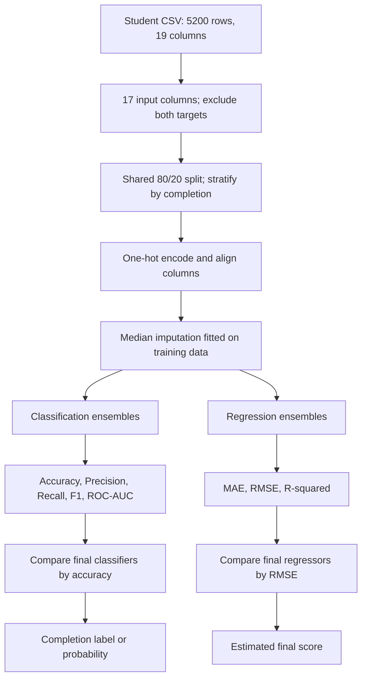

<!--
GITHUB UPLOAD: Place this README.md at the repository root and upload assets/readme/ alongside it.
VIDEO: Replace the header's href="#explanation-video" with your actual explanation-video URL when available.
Results below reproduce saved notebook outputs; they are not newly executed benchmarks.
-->

<a id="top"></a>

<div align="center">
  

  <h1>Smart Outcome Predictor</h1>
  <p><strong>Ensemble learning for course completion and final-score prediction</strong></p>
  <p>A practical machine-learning study that turns student learning activity into two understandable predictions.</p>

  

  <br><br>

  <a href="https://github.com/jeelprajapati0606/smart_outcome_predictor/blob/main/smart_outcome/Smart%20Outcome%20Predictor-checkpoint.ipynb"></a>
  <a href="https://colab.research.google.com/github/jeelprajapati0606/smart_outcome_predictor/blob/main/smart_outcome/Smart%20Outcome%20Predictor-checkpoint.ipynb"></a>
  <a href="https://github.com/jeelprajapati0606/smart_outcome_predictor/blob/main/smart_outcome/Smart_Outcome_Predictor_Dataset_5200%20-%20Smart_Outcome_Predictor_Dataset_5200.csv.csv"></a>
  <a href="https://github.com/jeelprajapati0606/smart_outcome_predictor/blob/main/smart_outcome/Part-G-Final-Report-Smart-Outcome-Predictor.pdf"></a>

  <br>

  <a href="https://github.com/jeelprajapati0606/smart_outcome_predictor"></a>
  <a href="#explanation-video"></a>

  <p><sub>Academic notebook project · 5,200 student records · Two prediction tasks · Seven ensemble approaches</sub></p>
</div>

---

## Contents

[Overview](#overview) · [Dataset](#dataset) · [Workflow](#workflow) · [Models](#models) · [Results](#results) · [Run the project](#run-the-project) · [Main code explained](#main-code-explained) · [Project files](#project-files) · [Reports](#reports-and-submission-map) · [Video](#explanation-video) · [Limitations](#limitations-and-next-steps)

## Overview

**Smart Outcome Predictor answers two questions about a student's learning journey:**

| Task | Question | Target | Model output |
| :--- | :--- | :--- | :--- |
| **Classification** | Will the student complete the course? | `completion_status` | `0` = Not Completed; `1` = Completed |
| **Regression** | What final score might the student achieve? | `final_score` | A numerical score estimate on a 0–100 target scale |

For example, the models can use a student's sessions, study time, quiz performance, and attendance to estimate completion and final performance. These are **separate models using the same input features**, not one model predicting both targets at once.

### Why ensemble learning?

One decision tree may make unstable predictions. An **ensemble** combines multiple models so their individual mistakes can be reduced. This project compares bagging, four boosting implementations, voting, and stacking instead of assuming that a more complex model must be better.

**The notebook covers:** data checks → train/test splitting → encoding and imputation → model training → tuning experiments → metric tables and comparison plots.

> **Project scope:** This repository contains an experimental Jupyter Notebook, a dataset, and PDF reports. It does not currently include a deployed website, prediction API, or saved production model.

## Dataset

The included CSV contains **5,200 rows and 19 columns**: **17 raw input columns** and **2 prediction targets**.

| Feature group | Columns used as inputs in the notebook |
| :--- | :--- |
| Identifier | `student_id` |
| Learner context | `age`, `country_region`, `device_type`, `education_background` |
| Course context | `course_level`, `course_category`, `course_start_date`, `week_of_year` |
| Learning activity | `sessions`, `time_spent_hours`, `videos_watched`, `quiz_attempts`, `assignments_submitted`, `forum_posts` |
| Performance indicators | `avg_quiz_score`, `attendance_rate` |

**Targets are not used as input features:** both `completion_status` and `final_score` are dropped from `X` before either model is trained.

### Data quality and preparation

| Check | Verified value / notebook behavior |
| :--- | :--- |
| Duplicate rows | `0` |
| Missing `time_spent_hours` values | `112` |
| Missing `avg_quiz_score` values | `81` |
| Missing `attendance_rate` values | `80` |
| Completion distribution | `3,248` Not Completed / `1,952` Completed — approximately `62.46%` / `37.54%` |
| Split | `80%` training / `20%` testing, stratified by `completion_status` |
| Rows after splitting | `4,160` training / `1,040` testing |
| Reproducible split seed | `random_state=42` |
| Categorical processing | `pd.get_dummies()` followed by train/test column alignment |
| Missing-value processing | Median imputer fitted on training data only |
| Encoded feature count | `396` columns in the saved notebook run |

The original notebook retains `student_id` and one-hot encodes the date string. These choices are documented here as implemented; better feature engineering is suggested under [Limitations](#limitations-and-next-steps).

## Workflow


1. **Load and inspect** the CSV: understand columns, missing values, duplicates, and targets.
2. **Separate features and targets:** use the same `X` for completion classification and score regression.
3. **Split once:** keep matching students in the training/test sets for both tasks.
4. **Prepare inputs:** one-hot encode categories, align columns, and fill missing values with training medians.
5. **Train ensembles:** compare the implemented model families using the prepared data.
6. **Evaluate:** use classification metrics for completion and regression metrics for scores.
7. **Summarize:** select the final comparison's classifier by accuracy and regressor by lowest RMSE.

<details>
<summary><strong>Editable Mermaid version of the workflow</strong></summary>



</details>

## Models


| Approach | Easy explanation | Implementation in this project |
| :--- | :--- | :--- |
| **Single Decision Tree** | One tree makes the decision. | Classification baseline for comparison with bagging |
| **Bagging** | Train many trees on resampled data and combine their predictions. | Classifier and regressor; `50` decision-tree estimators |
| **AdaBoost** | Add weak learners that give more attention to earlier mistakes. | Classifier and regressor; final comparison uses `50` estimators, `learning_rate=1.0` |
| **Gradient Boosting** | Add trees that reduce the current prediction loss. | Classifier and regressor; `100` estimators, `learning_rate=0.1` |
| **LightGBM** | Use efficient histogram-based, leaf-wise gradient boosting. | Classifier and regressor; `100` estimators, `learning_rate=0.1` |
| **XGBoost** | Use regularized gradient-boosted trees. | Classifier and regressor; `100` estimators, `learning_rate=0.1`, `max_depth=3` |
| **Voting** | Let different classifiers vote on the answer. | Scaled Logistic Regression + Decision Tree + Random Forest; hard and soft voting compared |
| **Stacking** | Train a second model to combine base-model predictions. | Decision Tree + Random Forest; `cv=5`; Logistic Regression meta-classifier / Linear Regression meta-regressor |

**Scaling:** the Logistic Regression member in the voting ensemble uses `StandardScaler()` inside a pipeline. The tree-based models use the encoded/imputed inputs without scaling.

## Results

> **Source and scope:** The following tables reproduce the saved notebook outputs from **Part F, Q28–Q30**. They are reference results for the final model objects, not new benchmark runs or proof of statistical superiority. The classification positive class is **Completed (`1`)**.


<details>
<summary><strong>What do the evaluation metrics mean?</strong></summary>

| Metric | Simple meaning |
| :--- | :--- |
| Accuracy | The fraction of all completion predictions that are correct. |
| Precision | Of the students predicted to complete, how many actually completed? |
| Recall | Of the students who actually completed, how many did the model identify? |
| F1 score | A balance between precision and recall. |
| ROC-AUC | How well the model ranks completed students above non-completed students across decision thresholds; it is not accuracy. |
| MAE | The average absolute difference between predicted and actual scores. |
| RMSE | A score-error measure that penalizes larger mistakes more strongly. |
| R² | Performance relative to predicting the test set's mean score; it can be negative. |

</details>

### Completion classification

Higher is better for each metric below. Accuracy is displayed as a percentage; the other metrics are on a 0–1 scale.

| Model | Accuracy | Precision | Recall | F1 score | ROC-AUC |
| :--- | ---: | ---: | ---: | ---: | ---: |
| Bagging | 72.40% | 0.6635 | 0.5359 | 0.5929 | 0.7629 |
| AdaBoost | 72.40% | 0.6575 | 0.5513 | 0.5997 | **0.7835** |
| Gradient Boosting | 73.27% | 0.6687 | **0.5692** | **0.6150** | 0.7809 |
| LightGBM | 71.06% | 0.6282 | 0.5590 | 0.5916 | 0.7655 |
| **XGBoost** | **73.37%** | **0.6749** | 0.5590 | 0.6115 | 0.7799 |
| Voting — hard | 69.62% | 0.6285 | 0.4641 | 0.5339 | N/A |
| Stacking | 71.15% | 0.6667 | 0.4615 | 0.5455 | 0.7537 |

**Reading the results:**

- **XGBoost has the highest accuracy in this final table.** Gradient Boosting has the highest F1 and recall; AdaBoost has the highest ROC-AUC. The preferred model depends on the objective.
- The single Decision Tree baseline achieved **63.94%** accuracy; bagging increased it to **72.40%**, a gain of about **8.46 percentage points**.
- The Q25 comparison recorded **69.62%** for hard voting and **67.31%** for soft voting. Soft voting is not automatically better.
- Hard voting produces class labels, so its ROC-AUC is left **N/A** rather than computed from hard predictions.
- XGBoost's accuracy lead over Gradient Boosting equals **one additional correct prediction out of 1,040 test rows**. It should not be treated as a proven meaningful difference.

### Final-score regression

Lower **MAE** and **RMSE** are better; higher **R²** is better.

| Model | MAE ↓ | RMSE ↓ | R² ↑ |
| :--- | ---: | ---: | ---: |
| Bagging | 8.2843 | 10.3332 | 0.4135 |
| AdaBoost | 8.7566 | 10.7164 | 0.3692 |
| Gradient Boosting | 8.1782 | 10.1592 | 0.4331 |
| LightGBM | 8.3360 | 10.3882 | 0.4072 |
| **XGBoost** | **8.1767** | **10.1351** | **0.4357** |
| Stacking | 8.2989 | 10.3541 | 0.4111 |

**In plain language:** XGBoost's average absolute score error was about **8.18 points** in this run. This is an average error, **not** a guaranteed “±8.18” interval for every student. Its R² of about `0.44` also shows that a large share of score variation remains unexplained.

### What the tuning and timing experiments show

| Experiment | Saved observation | Takeaway |
| :--- | :--- | :--- |
| AdaBoost, Q14 | `10 → 30 → 50 → 100` estimators gave `70.77% → 73.75% → 72.40% → 72.21%` accuracy. | Adding more weak learners did not always improve test accuracy. |
| Gradient Boosting, Q17 | `learning_rate=0.05, n_estimators=100` and `learning_rate=0.1, n_estimators=50` each reached approximately `73.56%`. | Learning rate and number of trees must be considered together. |
| Training efficiency, Q20 | Gradient Boosting: `7.1074 s`; LightGBM: `0.6983 s`. | LightGBM trained about `10.2×` faster in that one recorded run, with lower accuracy. Timing is machine-dependent. |

**Important distinction:** the exploratory AdaBoost result of `73.75%` is higher than the final table's XGBoost accuracy. “Best” in Q30 therefore means **best among the final model objects compared in Q28–Q29**, not best across every experiment. Because the test set was consulted repeatedly during tuning, fresh validation is needed before making a final generalization claim.

## Run the project

### 1. Clone the repository

```bash
git clone https://github.com/jeelprajapati0606/smart_outcome_predictor.git
cd smart_outcome_predictor
python -m venv .venv
```

### 2. Activate the environment

**macOS / Linux**

```bash
source .venv/bin/activate
```

**Windows PowerShell**

```powershell
.venv\Scripts\Activate.ps1
```

### 3. Install the notebook dependencies

```bash
python -m pip install --upgrade pip
python -m pip install pandas numpy "scikit-learn>=1.2" matplotlib lightgbm xgboost jupyter ipykernel
```

The notebook metadata records **Python 3.13.5**. The repository does not currently pin package versions or include a `requirements.txt`; the command above installs the required libraries rather than recreating the original environment exactly. Scores and timings can vary by library version and hardware.

### 4. Open the notebook from the correct folder

```bash
cd smart_outcome
jupyter notebook "Smart Outcome Predictor-checkpoint.ipynb"
```

Select the intended Python kernel, then use **Restart Kernel and Run All Cells** (wording may vary by Jupyter interface).

> **CSV path matters:** the notebook reads the dataset using its filename, so run it with `smart_outcome/` as the working directory. Keep the original CSV filename, including the spaces and the double `.csv.csv` extension.

<details>
<summary><strong>Run in Google Colab instead</strong></summary>

Use the **Run in Colab** button above. Opening a GitHub notebook does not automatically copy its CSV into the Colab runtime. Add and run this setup cell before the project's existing cells:

```python
!git clone https://github.com/jeelprajapati0606/smart_outcome_predictor.git
%cd /content/smart_outcome_predictor/smart_outcome
!pip -q install pandas numpy "scikit-learn>=1.2" matplotlib lightgbm xgboost
```

Then run the original notebook cells from top to bottom. Run the clone cell once per fresh runtime.

</details>

### Common setup issues

| Issue | What to check |
| :--- | :--- |
| `FileNotFoundError` for the CSV | Confirm the working directory is `smart_outcome/` and the filename is unchanged. |
| `ModuleNotFoundError` | Install dependencies in the same Python environment used by the notebook kernel. |
| Error involving `estimator=` in bagging | Use scikit-learn `1.2` or newer; the notebook uses the modern parameter name. |
| LightGBM import mentions `libomp` on macOS | Install the OpenMP runtime, for example `brew install libomp`, then restart the kernel. |
| Different results after rerunning | Check library versions, random seeds, and whether every cell was run in order. |

## Main code explained

These are selected excerpts from the actual notebook. They are explained in execution order and assume earlier data-preparation cells have already run. Imports and comments are shortened where useful.

<details open>
<summary><strong>1. Separate inputs from both prediction targets</strong></summary>

```python
import pandas as pd

filename = "Smart_Outcome_Predictor_Dataset_5200 - Smart_Outcome_Predictor_Dataset_5200.csv.csv"
df = pd.read_csv(filename)

X = df.drop(columns=["completion_status", "final_score"])
y_class = df["completion_status"]
y_reg = df["final_score"]
```

**Why it matters:** `X` contains the student information the models may use. `y_class` and `y_reg` contain the answers to learn. Dropping **both** targets prevents either answer from directly becoming an input to the other task.

</details>

<details>
<summary><strong>2. Create one reproducible split for both tasks</strong></summary>

```python
from sklearn.model_selection import train_test_split

X_train, X_test, y_class_train, y_class_test, y_reg_train, y_reg_test = (
    train_test_split(
        X, y_class, y_reg,
        test_size=0.2,
        random_state=42,
        stratify=y_class
    )
)
```

**Why it matters:** passing all three arrays together keeps the same students aligned across both prediction tasks. `stratify=y_class` approximately preserves the completion-class proportions in training and testing; it does not stratify the continuous regression target.

</details>

<details>
<summary><strong>3. Convert categories and fill missing values safely for the holdout</strong></summary>

```python
from sklearn.impute import SimpleImputer

X_train = pd.get_dummies(X_train)
X_test = pd.get_dummies(X_test)
X_train, X_test = X_train.align(
    X_test, join="left", axis=1, fill_value=0
)

imputer = SimpleImputer(strategy="median")
X_train = pd.DataFrame(
    imputer.fit_transform(X_train),
    columns=X_train.columns, index=X_train.index
)
X_test = pd.DataFrame(
    imputer.transform(X_test),
    columns=X_test.columns, index=X_test.index
)
```

**Why it matters:** one-hot encoding turns text categories into numeric indicator columns. Alignment keeps the test columns consistent with training. `fit_transform()` learns medians from training data; `transform()` reuses them on the test set. The test rows do not determine the fill values.

**Next improvement:** use `ColumnTransformer` and `OneHotEncoder(handle_unknown="ignore")` inside a full pipeline so preprocessing can be fitted independently within each cross-validation fold.

</details>

<details>
<summary><strong>4. Train many trees with bagging</strong></summary>

```python
from sklearn.ensemble import BaggingClassifier
from sklearn.tree import DecisionTreeClassifier

bag_clf = BaggingClassifier(
    estimator=DecisionTreeClassifier(),
    n_estimators=50,
    random_state=42,
    n_jobs=-1
)
bag_clf.fit(X_train, y_class_train)
pred_class = bag_clf.predict(X_test)
```

**Why it matters:** rather than trust one tree, bagging trains `50` trees on bootstrap samples and combines their predictions. `n_jobs=-1` allows available CPU cores to be used. The notebook also trains a `BaggingRegressor` with decision-tree regressors for numerical scores.

</details>

<details>
<summary><strong>5. Use XGBoost for the two separate outcomes</strong></summary>

```python
from xgboost import XGBClassifier, XGBRegressor

xgb_clf = XGBClassifier(
    n_estimators=100,
    learning_rate=0.1,
    max_depth=3,
    eval_metric="logloss",
    random_state=42
)
xgb_clf.fit(X_train, y_class_train)

xgb_reg = XGBRegressor(
    n_estimators=100,
    learning_rate=0.1,
    max_depth=3,
    objective="reg:squarederror",
    random_state=42
)
xgb_reg.fit(X_train, y_reg_train)
```

**Why it matters:** both models build boosted trees, but their objectives are different. The classifier learns completion classes; the regressor learns scores. `n_estimators` controls the number of boosting rounds, `learning_rate` controls each round's contribution, and `max_depth` limits tree complexity. No early-stopping configuration is used in these notebook calls.

</details>

<details>
<summary><strong>6. Understand voting and the stacking meta-learner</strong></summary>

The voting ensemble combines three members: a **scaled Logistic Regression**, a **Decision Tree**, and a **50-tree Random Forest**. In hard voting, the majority class wins. In soft voting, the average predicted class probabilities determine the result.

The stacking classifier instead learns how to combine a Decision Tree and a Random Forest:

```python
from sklearn.ensemble import StackingClassifier, RandomForestClassifier
from sklearn.tree import DecisionTreeClassifier
from sklearn.linear_model import LogisticRegression

stack_clf = StackingClassifier(
    estimators=[
        ("dt", DecisionTreeClassifier(random_state=42)),
        ("rf", RandomForestClassifier(
            n_estimators=50, random_state=42
        ))
    ],
    final_estimator=LogisticRegression(max_iter=1000),
    cv=5
)
stack_clf.fit(X_train, y_class_train)
```

**Why it matters:** `cv=5` produces out-of-fold base-model predictions to train the meta-learner, rather than training it only on in-sample predictions. The regression counterpart uses Decision Tree and Random Forest regressors with **Linear Regression** as the final estimator.

</details>

<details>
<summary><strong>7. Evaluate predictions and select the final comparison winners</strong></summary>

For classifiers that provide probabilities, the notebook uses the probability of class `1` for ROC-AUC:

```python
from sklearn.metrics import roc_auc_score

probability = xgb_clf.predict_proba(X_test)[:, 1]
auc = roc_auc_score(y_class_test, probability)
```

For regression, it measures errors against the true final scores:

```python
import numpy as np
from sklearn.metrics import mean_absolute_error, mean_squared_error, r2_score

pred = xgb_reg.predict(X_test)
mae = mean_absolute_error(y_reg_test, pred)
rmse = np.sqrt(mean_squared_error(y_reg_test, pred))
r2 = r2_score(y_reg_test, pred)
```

After collecting metrics into DataFrames, Q30 selects the winners:

```python
best_classification = classification_results.sort_values(
    by="Accuracy", ascending=False
).iloc[0]

best_regression = regression_results.sort_values(
    by="RMSE", ascending=True
).iloc[0]
```

**Why it matters:** the selection rule is explicit. “Best classifier” here means highest **accuracy**, not necessarily highest recall, F1, or ROC-AUC. The choice of metric should match the eventual use case.

</details>

## Project files

After adding this README and its visual assets, the repository layout is:

```text
smart_outcome_predictor/
├── README.md
├── assets/
│   └── readme/                       # Header/footer GIFs, SVG buttons and diagrams
└── smart_outcome/
    ├── Smart Outcome Predictor-checkpoint.ipynb
    ├── Smart_Outcome_Predictor_Dataset_5200 - Smart_Outcome_Predictor_Dataset_5200.csv.csv
    ├── Part-A-Ensemble-Learning-QA.pdf
    └── Part-G-Final-Report-Smart-Outcome-Predictor.pdf
```

The `assets/readme/` folder is documentation-only; it does not change the training code.

## Reports and submission map

| Part | Topic | Where to find it |
| :--- | :--- | :--- |
| **A · Q1–Q5** | Ensemble-learning theory | [Conceptual Q&A PDF](smart_outcome/Part-A-Ensemble-Learning-QA.pdf) |
| **B · Q6–Q8** | Dataset understanding, splitting, and preprocessing | [Project notebook](smart_outcome/Smart%20Outcome%20Predictor-checkpoint.ipynb) |
| **C · Q9–Q11** | Bagging classifier/regressor and single-tree comparison | Project notebook |
| **D · Q12–Q23** | AdaBoost, Gradient Boosting, LightGBM, XGBoost, tuning, and comparisons | Project notebook |
| **E · Q24–Q27** | Voting, hard vs soft voting, stacking classifier/regressor | Project notebook |
| **F · Q28–Q30** | Classification/regression metrics and final model comparison | Project notebook; summary tables above |
| **G · Q31–Q32** | Final analysis, interpretation, and submission contents | [Final report PDF](smart_outcome/Part-G-Final-Report-Smart-Outcome-Predictor.pdf) |

The notebook includes plots for AdaBoost estimator counts, Gradient Boosting learning-rate experiments, classification accuracy, and regression RMSE. For numerical results in this README, the notebook's saved evaluation outputs are the reference; the class counts above were checked directly against the CSV.

## Explanation video

**Video status: link not added yet.** The header's explanation-video button currently opens this section; it does not point to an existing video.

Once a video is uploaded to YouTube, Google Drive, or another host, replace the header's `href="#explanation-video"` with its shareable URL. Switch the image from `button-video-pending.svg` to the included `button-video.svg` (width `276`) to remove the pending label. For a Markdown-only button, use:

```markdown
[](YOUR_EXPLANATION_VIDEO_URL)
```

**Suggested explanation order:** problem statement → dataset and targets → preprocessing → bagging and boosting → voting and stacking → results and limitations → how to run the notebook.

## Limitations and next steps

- **Use stronger validation.** The current notebook repeatedly inspects the same test split for tuning. Use a train/validation/test design or nested cross-validation, then evaluate once on an untouched test set.
- **Fit preprocessing within folds.** The holdout imputer uses training data only, but preprocessing is completed before stacking's internal cross-validation. Move it into fold-fitted pipelines for cleaner validation.
- **Improve feature design.** Review whether `student_id` should be removed; replace date-string dummy columns with meaningful calendar features. Verify that every input would actually be available at the intended prediction time.
- **Measure uncertainty and class trade-offs.** Add confidence intervals, confusion matrices, calibration checks, and threshold analysis. A higher accuracy does not automatically mean better identification of students who need support.
- **Do not overstate robustness or importance.** The current comparisons do not establish statistical significance, performance on future cohorts, or which features are most important. Add temporal/external validation and feature-importance analysis before making those claims.
- **Package the experiment before deployment.** Pin dependencies, save the complete preprocessing-plus-model workflow, and test inference on new records. Predicted scores are estimates; the present regressor does not enforce a 0–100 output bound.
- **Use predictions responsibly.** Treat the project as decision support, not an automatic pass/fail system. Consider access differences, privacy, fairness, and human review before any real educational use.

## Author and licensing

**Repository owner:** [@jeelprajapati0606](https://github.com/jeelprajapati0606)  
**Repository:** [smart_outcome_predictor](https://github.com/jeelprajapati0606/smart_outcome_predictor)

No license file is currently included in the repository. Add a `LICENSE` file if you want to explicitly define reuse and distribution terms.

---

<div align="center">
  <a href="#top">Back to top</a>
  <br><br>
  
  <p><sub>Understand the data. Compare the models. Communicate the limitations.</sub></p>
</div>
