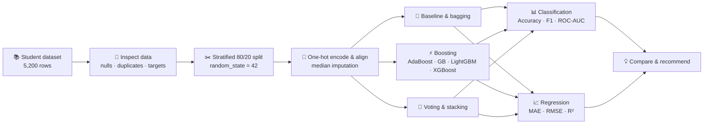
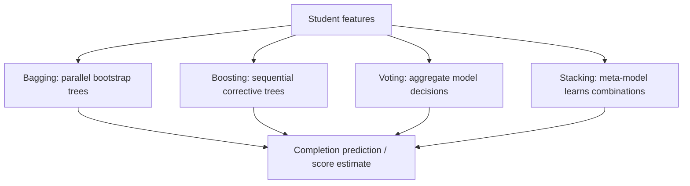
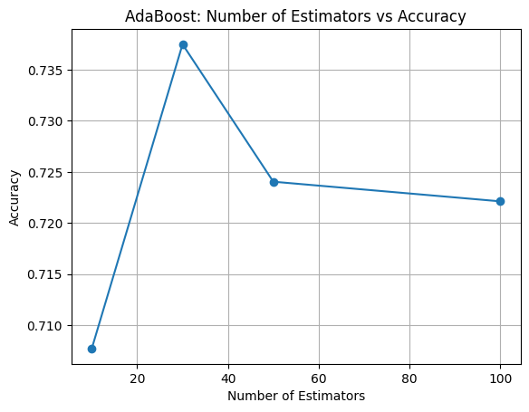
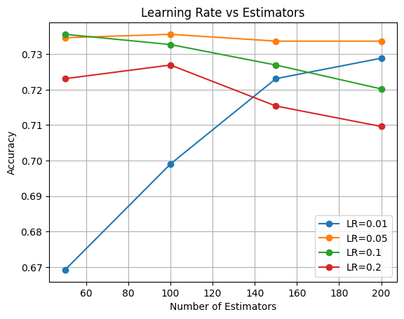
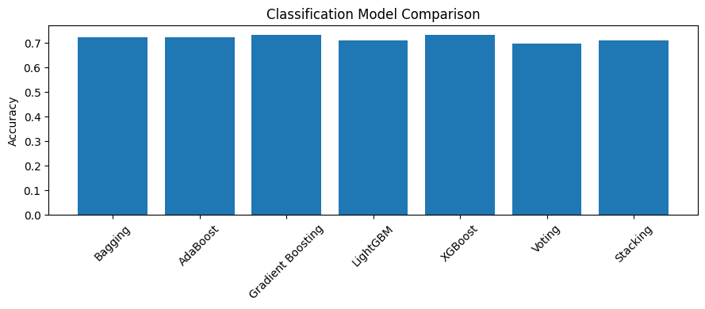
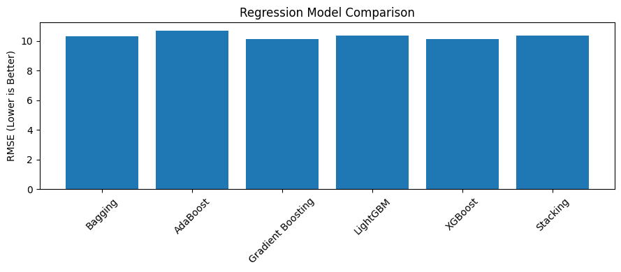

<div align="center">


### Turning student engagement into actionable insight

**One dataset · Two prediction tasks · Seven ensemble approaches**


[](smart_outcome/Smart%20Outcome%20Predictor-checkpoint.ipynb)
[](smart_outcome/Smart_Outcome_Predictor_Dataset_5200%20-%20Smart_Outcome_Predictor_Dataset_5200.csv.csv)
[](smart_outcome/Project-Questions.pdf)
[](smart_outcome/Part-A-Ensemble-Learning-QA.pdf)
[](smart_outcome/Part-G-Final-Report-Smart-Outcome-Predictor.pdf)


<sub>The video badge is intentionally inactive until an explanation-video URL is available.</sub>

</div>

---

## 🧭 Navigation

- [Project overview](#-project-overview) · [Workflow](#-end-to-end-workflow) · [Dataset](#-dataset-at-a-glance)
- [Getting started](#-getting-started) · [Ensemble theory](#-ensemble-learning-in-a-nutshell) · [Notebook walkthrough](#-notebook-walkthrough)
- [Results](#-model-evaluation--results) · [Interpretation](#-key-insights--business-interpretation) · [Limitations](#-limitations--next-steps)

## 🎯 Project overview

Online learning platforms generate rich signals about student behavior, but a single model can be unstable or miss important patterns. This project explores whether combining learners can produce more useful predictions of student outcomes.

| Task | Question | Target | Output |
|:--|:--|:--|:--|
| **Classification** | Will a student complete the course? | `completion_status` | `0` = not completed, `1` = completed |
| **Regression** | What will the student's final score be? | `final_score` | Numeric score, on a 0–100 scale |

The notebook walks through data preparation, a single-tree baseline, bagging, four boosting algorithms, voting, stacking, evaluation and visualizations. The companion PDFs cover the theory and final report.

> **Project snapshot:** 5,200 records · 19 original columns · 80/20 split · 396 features after encoding · saved results from one held-out test split.

## 🗺️ End-to-end workflow



**Model families at a glance**



## 📦 Dataset at a glance

The supplied CSV contains **5,200 rows and 19 columns**. The notebook reports **zero duplicate rows** and missing values in three fields:

| Field | Missing values |
|:--|--:|
| `time_spent_hours` | 112 |
| `avg_quiz_score` | 81 |
| `attendance_rate` | 80 |

<details>
<summary><b>View the complete data dictionary</b></summary>

| Group | Columns | Role |
|:--|:--|:--|
| Identifier | `student_id` | Student identifier; retained as a feature in the notebook |
| Demographics | `age`, `country_region`, `device_type`, `education_background` | Learner context |
| Course | `course_level`, `course_category`, `course_start_date`, `week_of_year` | Course and timing context |
| Engagement | `sessions`, `time_spent_hours`, `videos_watched`, `quiz_attempts`, `assignments_submitted`, `forum_posts` | Activity signals |
| Assessment | `avg_quiz_score`, `attendance_rate` | Performance and participation signals |
| Targets | `completion_status`, `final_score` | Classification and regression labels, respectively |

Both target columns are removed from `X` for **both** tasks. The notebook includes `student_id` and one-hot encodes the raw date; see [limitations](#-limitations--next-steps) before deployment.

</details>

## 🛠️ Getting started

### 1. Clone the repository

```bash
git clone https://github.com/jeelprajapati0606/smart_outcome_predictor.git
cd smart_outcome_predictor/smart_outcome
```

### 2. Create an environment and install dependencies

```bash
python -m venv .venv
# macOS / Linux
source .venv/bin/activate
# Windows PowerShell: .venv\Scripts\Activate.ps1

python -m pip install --upgrade pip
python -m pip install pandas numpy matplotlib scikit-learn lightgbm xgboost notebook
```

The notebook uses `estimator=` in scikit-learn bagging classes, requiring **scikit-learn 1.2 or newer**. Dependencies are not pinned in the repository; versions, operating system and hardware may affect results and run times. LightGBM installation may require a working OpenMP runtime on some systems.

### 3. Launch and run

```bash
jupyter notebook
```

Open **`Smart Outcome Predictor-checkpoint.ipynb`** and run all cells in order. Start Jupyter in `smart_outcome/` so the notebook's relative CSV path resolves correctly. Some ensemble and tuning cells may take a while to train.

### Project structure

```text
smart_outcome_predictor/
├── README.md
├── assets/
│   ├── hero.svg
│   ├── adaboost-estimators.png
│   ├── gradient-boosting-tuning.png
│   ├── classification-comparison.png
│   └── regression-comparison.png
└── smart_outcome/
    ├── Smart Outcome Predictor-checkpoint.ipynb
    ├── Smart_Outcome_Predictor_Dataset_5200 - Smart_Outcome_Predictor_Dataset_5200.csv.csv
    ├── Project-Questions.pdf
    ├── Part-A-Ensemble-Learning-QA.pdf
    └── Part-G-Final-Report-Smart-Outcome-Predictor.pdf
```

## 🧠 Ensemble learning in a nutshell

| Concept | What it does | Why it matters |
|:--|:--|:--|
| **Ensemble learning** | Combines multiple models into one prediction. | Diverse errors can offset one another, improving generalization. |
| **Bagging** | Trains independent learners on bootstrap samples and aggregates them. | Primarily reduces variance, especially for unstable trees. |
| **Boosting** | Adds learners sequentially to correct earlier errors or reduce loss. | Often reduces bias, but can overfit or be sensitive to noise. |
| **Voting** | Combines predictions from different models. | Simple, interpretable way to use model diversity. |
| **Stacking** | Trains a meta-learner on cross-validated base-model predictions. | Learns how to combine complementary models. |
| **Bias–variance trade-off** | Balances underfitting against sensitivity to training data. | The right ensemble depends on the data and validation strategy. |

**Boosting family:** AdaBoost emphasizes difficult examples; Gradient Boosting fits successive learners to a loss gradient; LightGBM uses histogram-based tree learning and leaf-wise growth for efficiency; XGBoost implements regularized gradient boosting with efficient tree construction. These are conceptual distinctions, not a guarantee that one is always best.

## 🔬 Notebook walkthrough

The following excerpts mirror the notebook's main implementation. Run the full notebook for complete imports, outputs and plots; the snippets are organized in execution order, with a few repetitive lines condensed.

### 01 · Inspect, split and prepare the data

The notebook loads the CSV, inspects shape, column names, null counts and duplicates, then performs a **shared stratified split** for both targets. Categorical columns—including the date string—are one-hot encoded; test columns are aligned to training columns. A median imputer is fitted on training data only. This produces **4,160 × 396** training and **1,040 × 396** test matrices.

```python
import numpy as np
import pandas as pd
from sklearn.model_selection import train_test_split
from sklearn.impute import SimpleImputer

df = pd.read_csv(
    "Smart_Outcome_Predictor_Dataset_5200 - "
    "Smart_Outcome_Predictor_Dataset_5200.csv.csv"
)
print(df.shape, df.isnull().sum(), df.duplicated().sum())

X = df.drop(columns=["completion_status", "final_score"])
y_class = df["completion_status"]
y_reg = df["final_score"]

X_train, X_test, y_class_train, y_class_test, y_reg_train, y_reg_test = (
    train_test_split(X, y_class, y_reg, test_size=0.2,
                     random_state=42, stratify=y_class)
)
X_train = pd.get_dummies(X_train)
X_test = pd.get_dummies(X_test)
X_train, X_test = X_train.align(X_test, join="left", axis=1, fill_value=0)

imputer = SimpleImputer(strategy="median")
X_train = pd.DataFrame(imputer.fit_transform(X_train),
                       columns=X_train.columns, index=X_train.index)
X_test = pd.DataFrame(imputer.transform(X_test),
                      columns=X_test.columns, index=X_test.index)
```

### 02 · Bagging: strength in parallel trees

Each tree is trained on a bootstrap sample. Predictions are aggregated by majority vote for classification or averaging for regression. On the saved test split, bagging improves classifier accuracy from **0.6394** for one decision tree to **0.7240**.

```python
from sklearn.tree import DecisionTreeClassifier, DecisionTreeRegressor
from sklearn.ensemble import BaggingClassifier, BaggingRegressor
from sklearn.metrics import accuracy_score

single_tree = DecisionTreeClassifier(random_state=42)
single_tree.fit(X_train, y_class_train)

bag_clf = BaggingClassifier(estimator=DecisionTreeClassifier(),
                            n_estimators=50, random_state=42, n_jobs=-1)
bag_reg = BaggingRegressor(estimator=DecisionTreeRegressor(),
                          n_estimators=50, random_state=42, n_jobs=-1)
bag_clf.fit(X_train, y_class_train)
bag_reg.fit(X_train, y_reg_train)
print("Single tree:", accuracy_score(y_class_test, single_tree.predict(X_test)))
print("Bagging:", accuracy_score(y_class_test, bag_clf.predict(X_test)))
```

### 03 · AdaBoost: learn from previous mistakes

AdaBoost builds learners in sequence, assigning more attention to difficult cases. The notebook trains both a classifier and a regressor with 50 estimators and learning rate 1.0.

```python
from sklearn.ensemble import AdaBoostClassifier, AdaBoostRegressor

ada_clf = AdaBoostClassifier(n_estimators=50, learning_rate=1.0, random_state=42)
ada_reg = AdaBoostRegressor(n_estimators=50, learning_rate=1.0, random_state=42)
ada_clf.fit(X_train, y_class_train)
ada_reg.fit(X_train, y_reg_train)
```

The notebook also tests **10, 30, 50 and 100** estimators. Their saved accuracies are **0.7077, 0.7375, 0.7240 and 0.7221**, respectively: more estimators do not automatically improve the result.



### 04 · Gradient Boosting: optimize the loss step by step

Gradient Boosting adds trees sequentially to reduce the current loss. The main classifier and regressor use 100 estimators and learning rate 0.1.

```python
from sklearn.ensemble import GradientBoostingClassifier, GradientBoostingRegressor

gb_clf = GradientBoostingClassifier(n_estimators=100, learning_rate=0.1,
                                    random_state=42)
gb_reg = GradientBoostingRegressor(n_estimators=100, learning_rate=0.1,
                                   random_state=42)
gb_clf.fit(X_train, y_class_train)
gb_reg.fit(X_train, y_reg_train)
```

The notebook additionally explores learning rates `[0.01, 0.05, 0.1, 0.2]` and estimator counts `[50, 100, 150, 200]`. The best displayed grid accuracy is **0.7356**, achieved by both `(0.05, 100)` and `(0.1, 50)` on the test split. This is an exploratory test-set comparison, not an unbiased tuned-model estimate.



### 05 · LightGBM: efficient gradient boosting

LightGBM uses histogram-based training and leaf-wise tree growth. The notebook trains classifier and regressor variants and records an illustrative single-run timing comparison.

```python
from lightgbm import LGBMClassifier, LGBMRegressor

lgbm_clf = LGBMClassifier(n_estimators=100, learning_rate=0.1,
                         verbosity=-1, random_state=42)
lgbm_reg = LGBMRegressor(n_estimators=100, learning_rate=0.1,
                         verbosity=-1, random_state=42)
lgbm_clf.fit(X_train, y_class_train)
lgbm_reg.fit(X_train, y_reg_train)
```

In the saved run, LightGBM took **0.6983 s** versus **7.1074 s** for scikit-learn Gradient Boosting; accuracy was **0.7106** versus **0.7327**. These are environment-specific, single-run measurements—not a general benchmark.

### 06 · XGBoost: regularized boosting

The main XGBoost models use 100 estimators, learning rate 0.1 and maximum depth 3. In the final comparison they lead on classification accuracy and regression RMSE.

```python
from xgboost import XGBClassifier, XGBRegressor

xgb_clf = XGBClassifier(n_estimators=100, learning_rate=0.1, max_depth=3,
                        eval_metric="logloss", random_state=42)
xgb_reg = XGBRegressor(n_estimators=100, learning_rate=0.1, max_depth=3,
                        objective="reg:squarederror", random_state=42)
xgb_clf.fit(X_train, y_class_train)
xgb_reg.fit(X_train, y_reg_train)
```

The notebook also runs a **separate** boosting comparison with different parameters, including XGBoost's default learning rate and AdaBoost with 100 estimators. There, Gradient Boosting leads at **0.7327 accuracy** and XGBoost scores **0.7269**. It should not be confused with the final table's configurations.

### 07 · Voting: combine different perspectives

The voting ensemble combines scaled logistic regression, a decision tree and a random forest. **Hard voting** selects the majority class; **soft voting** averages predicted class probabilities. In this run, hard voting scores **0.6962** accuracy and soft voting **0.6731**.

```python
from sklearn.linear_model import LogisticRegression
from sklearn.pipeline import make_pipeline
from sklearn.preprocessing import StandardScaler
from sklearn.tree import DecisionTreeClassifier
from sklearn.ensemble import RandomForestClassifier, VotingClassifier

def create_voter(voting_type):
    return VotingClassifier(
        estimators=[
            ("lr", make_pipeline(StandardScaler(), LogisticRegression(max_iter=3000))),
            ("dt", DecisionTreeClassifier(random_state=42)),
            ("rf", RandomForestClassifier(n_estimators=50, random_state=42)),
        ],
        voting=voting_type,
    )

hard_model = create_voter("hard").fit(X_train, y_class_train)
soft_model = create_voter("soft").fit(X_train, y_class_train)
```

The final table uses the notebook's **hard** voter. It has no probability output, so ROC-AUC is reported as unavailable.

### 08 · Stacking: learn how to combine models

The stack uses a decision tree and random forest as base models, then learns a combination with logistic regression for classification or linear regression for score prediction. The notebook specifies `cv=5` to produce cross-validated base predictions for the meta-learner.

```python
from sklearn.ensemble import (StackingClassifier, StackingRegressor,
                              RandomForestClassifier, RandomForestRegressor)
from sklearn.tree import DecisionTreeClassifier, DecisionTreeRegressor
from sklearn.linear_model import LogisticRegression, LinearRegression

stack_clf = StackingClassifier(
    estimators=[("dt", DecisionTreeClassifier(random_state=42)),
                ("rf", RandomForestClassifier(n_estimators=50, random_state=42))],
    final_estimator=LogisticRegression(max_iter=1000), cv=5,
)
stack_reg = StackingRegressor(
    estimators=[("dt", DecisionTreeRegressor(random_state=42)),
                ("rf", RandomForestRegressor(n_estimators=50, random_state=42))],
    final_estimator=LinearRegression(), cv=5,
)
stack_clf.fit(X_train, y_class_train)
stack_reg.fit(X_train, y_reg_train)
```

## 📊 Model evaluation & results

All numbers below are **saved notebook outputs**, rounded to four decimals, on the same 1,040-row test split. They are not cross-validated estimates, and may change with library versions. The notebook chooses the best classification model by **accuracy** and the best regression model by **lowest RMSE**.

### Classification leaderboard

| Model | Accuracy ↑ | Precision ↑ | Recall ↑ | F1 ↑ | ROC-AUC ↑ |
|:--|--:|--:|--:|--:|--:|
| Bagging | 0.7240 | 0.6635 | 0.5359 | 0.5929 | 0.7629 |
| AdaBoost | 0.7240 | 0.6575 | 0.5513 | 0.5997 | **0.7835** |
| Gradient Boosting | 0.7327 | 0.6687 | **0.5692** | **0.6150** | 0.7809 |
| LightGBM | 0.7106 | 0.6282 | 0.5590 | 0.5916 | 0.7655 |
| **XGBoost** | **0.7337** | **0.6749** | 0.5590 | 0.6115 | 0.7799 |
| Hard Voting | 0.6962 | 0.6285 | 0.4641 | 0.5339 | N/A |
| Stacking | 0.7115 | 0.6667 | 0.4615 | 0.5455 | 0.7537 |



### Regression leaderboard

| Model | MAE ↓ | RMSE ↓ | R² ↑ |
|:--|--:|--:|--:|
| Bagging | 8.2843 | 10.3332 | 0.4135 |
| AdaBoost | 8.7566 | 10.7164 | 0.3692 |
| Gradient Boosting | 8.1782 | 10.1592 | 0.4331 |
| LightGBM | 8.3360 | 10.3882 | 0.4072 |
| **XGBoost** | **8.1767** | **10.1351** | **0.4357** |
| Stacking | 8.2989 | 10.3541 | 0.4111 |



### What do the metrics mean?

- **Accuracy:** fraction of all classifications that are correct.
- **Precision:** among predicted completers, the fraction who completed.
- **Recall:** among actual completers, the fraction correctly identified. If the operational goal is identifying **non-completers**, evaluate that class separately.
- **F1:** harmonic mean of precision and recall for the positive class.
- **ROC-AUC:** how well prediction scores rank positives above negatives; it requires a probability or decision score.
- **MAE:** average absolute score error, in score points. **RMSE** weights larger errors more heavily.
- **R²:** proportion of test-set target variation explained relative to a mean-prediction baseline; it can be negative.

<details>
<summary><b>View the evaluation and model-selection code</b></summary>

```python
from sklearn.metrics import (accuracy_score, precision_score, recall_score,
                             f1_score, roc_auc_score, mean_absolute_error,
                             mean_squared_error, r2_score)

classification_models = {
    "Bagging": bag_clf, "AdaBoost": ada_clf, "Gradient Boosting": gb_clf,
    "LightGBM": lgbm_clf, "XGBoost": xgb_clf,
    "Voting": hard_model, "Stacking": stack_clf,
}
classification_results = []
for name, model in classification_models.items():
    pred = model.predict(X_test)
    auc = (roc_auc_score(y_class_test, model.predict_proba(X_test)[:, 1])
           if hasattr(model, "predict_proba") else np.nan)
    classification_results.append({
        "Model": name, "Accuracy": accuracy_score(y_class_test, pred),
        "Precision": precision_score(y_class_test, pred, zero_division=0),
        "Recall": recall_score(y_class_test, pred, zero_division=0),
        "F1 Score": f1_score(y_class_test, pred, zero_division=0), "ROC-AUC": auc,
    })
classification_results = pd.DataFrame(classification_results)

regression_models = {
    "Bagging": bag_reg, "AdaBoost": ada_reg, "Gradient Boosting": gb_reg,
    "LightGBM": lgbm_reg, "XGBoost": xgb_reg, "Stacking": stack_reg,
}
regression_results = []
for name, model in regression_models.items():
    pred = model.predict(X_test)
    regression_results.append({
        "Model": name, "MAE": mean_absolute_error(y_reg_test, pred),
        "RMSE": np.sqrt(mean_squared_error(y_reg_test, pred)),
        "R2 Score": r2_score(y_reg_test, pred),
    })
regression_results = pd.DataFrame(regression_results)

best_classifier = classification_results.sort_values("Accuracy", ascending=False).iloc[0]
best_regressor = regression_results.sort_values("RMSE").iloc[0]
print(best_classifier, best_regressor)
```

</details>

## 💡 Key insights & business interpretation

1. **Bagging improves the tree baseline:** an increase of approximately **8.46 percentage points** in classification accuracy on this split.
2. **XGBoost is the notebook's leader by its chosen criteria:** **73.37%** accuracy and **10.14** score-point RMSE. Gradient Boosting is very close, with stronger positive-class F1; AdaBoost has the highest ROC-AUC. The preferred model depends on the actual decision metric.
3. **Voting and stacking are not automatic wins:** diversity helps only when base models and combination methods complement one another. Both voting variants and stacking underperform the best boosting models here.
4. **Training cost matters:** the recorded LightGBM run was faster but less accurate than Gradient Boosting on this dataset. Repeated, controlled benchmarks are needed before making a performance claim.
5. **Potential use:** completion risk estimates could help educators prioritize supportive outreach, while predicted scores could inform extra learning resources. Predictions are not causal explanations or substitutes for human judgment.

**Recommendation:** Treat XGBoost as a **candidate for further validation**, not a production-ready winner. Choose a metric aligned with the intervention, compare against simple baselines, validate on future cohorts and audit subgroup performance before deployment.

## ⚠️ Limitations & next steps

- **Test-set reuse:** estimator sweeps and model comparisons inspect the same test split. Use a separate validation set or nested cross-validation for selection, then evaluate once on an untouched test set.
- **Prediction timing & leakage:** verify every feature is available at the intended prediction time. Engagement, attendance or assessment values collected after an outcome would leak future information. Neither target is used as a feature, but that alone does not eliminate leakage.
- **Identifiers and dates:** `student_id` is retained and `course_start_date` is one-hot encoded, generating many columns. Evaluate dropping identifiers, engineering date features and using temporal or group-aware splits when appropriate.
- **Preprocessing & stacking:** the notebook fits imputation before stacking's internal cross-validation. Use preprocessing pipelines within cross-validation to avoid fold-level leakage; use `OneHotEncoder(handle_unknown="ignore")` for reproducible inference.
- **Fairness and safety:** assess performance across relevant cohorts, protect student data, measure calibration and set appropriate intervention thresholds. Do not use predictions for punitive or automated high-stakes decisions.
- **Robustness:** report confidence intervals and repeat across splits, validate on later cohorts, inspect errors and monitor drift. The notebook's comparison alone does not establish robustness.
- **Reproducibility & deployment:** pin dependencies, serialize the complete preprocessing/model pipeline, test inference, track model versions and monitor outcomes. No deployed service or trained artifact is provided here.

## 📚 Project deliverables

| Resource | Description |
|:--|:--|
| [Jupyter notebook](smart_outcome/Smart%20Outcome%20Predictor-checkpoint.ipynb) | Code, saved outputs, comparisons and plots for Parts B–F |
| [Dataset](smart_outcome/Smart_Outcome_Predictor_Dataset_5200%20-%20Smart_Outcome_Predictor_Dataset_5200.csv.csv) | Student-level data used by the notebook |
| [Project questions](smart_outcome/Project-Questions.pdf) | PDF compiled from the supplied project-question screenshots |
| [Theory PDF](smart_outcome/Part-A-Ensemble-Learning-QA.pdf) | Part A: ensemble learning concepts |
| [Final report](smart_outcome/Part-G-Final-Report-Smart-Outcome-Predictor.pdf) | Part G: final analysis and reporting |
| Explanation video | Link not supplied; replace the inactive badge when a URL is available |

---

<div align="center">
  <b>Built around a simple idea: better learning outcomes start with better signals.</b><br/>
  <sub>Smart Outcome Predictor · Ensemble learning for EdTech</sub>
</div>
